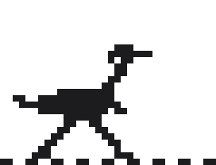
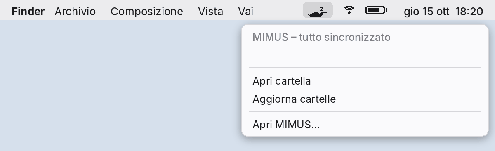
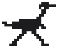
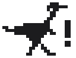
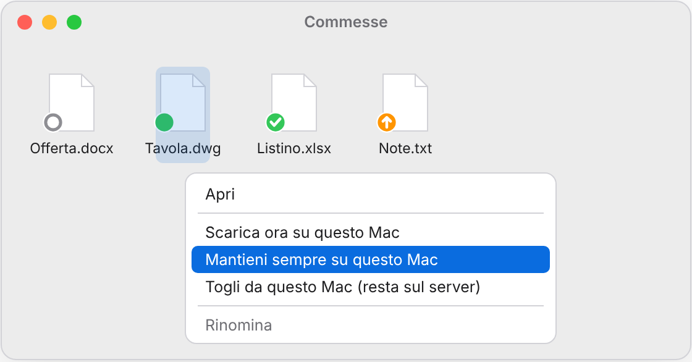
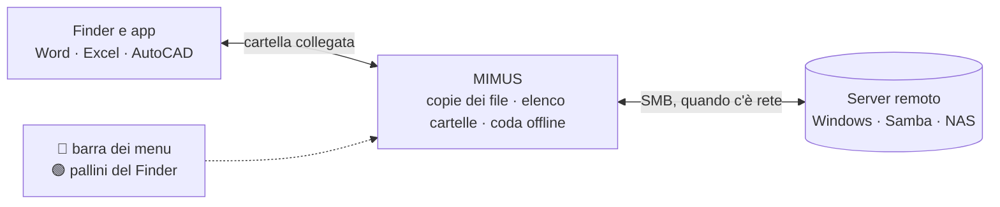

<p align="center">
  <picture>
    <source media="(prefers-color-scheme: dark)" srcset="docs/img/dino-dark.gif">
    
  </picture>
</p>

<h1 align="center">MIMUS</h1>

<p align="center">
  <b>La cartella del server sul tuo Mac.<br>Veloce come un disco, anche quando la rete non c'è.</b>
</p>

<p align="center">
  <a href="https://github.com/ranzaWARE/mimus/releases/latest"></a>
  
  
  <a href="LICENSE"></a>
  
</p>

MIMUS collega al Mac una cartella condivisa (un server Windows, Samba o un NAS) e te la mette nel Finder **come se fosse tua**.
Apri i file con qualsiasi app (Word, Excel, AutoCAD con i riferimenti esterni, Photoshop…), lavori in treno senza rete, e appena torni in ufficio tutto torna sul server da solo.
Niente da imparare: è una cartella.

## ✨ Cosa sa fare

<table>
  <tr><td width="32%">🗂️ <b>Tutta la struttura, sempre</b></td><td>Vedi tutte le cartelle del server anche offline e dopo un riavvio.</td></tr>
  <tr><td width="32%">⚡ <b>File al volo</b></td><td>I file si scaricano quando li apri e restano sul Mac: la volta dopo si aprono a velocità di disco (150–300 MB/s).</td></tr>
  <tr><td width="32%">✈️ <b>Offline senza pensieri</b></td><td>Modifichi, crei, rinomini, cancelli: MIMUS mette tutto in coda e lo applica sul server quando torni in rete, nell'ordine giusto.</td></tr>
  <tr><td width="32%">🤝 <b>Conflitti chiari</b></td><td>Se un collega ha cambiato lo stesso file, ti chiede cosa fare: <i>Scarta la mia</i>, <i>Tieni entrambe</i> o <i>Sovrascrivi</i>. Senza risposta vale sempre la scelta che non perde dati.</td></tr>
  <tr><td width="32%">🛡️ <b>Collaudato contro la perdita di dati</b></td><td>A ogni versione 64 scenari provati con un server Samba vero e su un Mac vero, scelti anche dai problemi noti di strumenti simili: corrente che va via, rete che cade a metà caricamento, disco pieno, colleghi che modificano, cancellano o rinominano mentre lavori offline, salvataggi di Word e AutoCAD, due Mac sullo stesso file, il server che perde una cartella. Se uno solo fallisce, la versione non esce.</td></tr>
  <tr><td width="32%">👀 <b>Novità dei colleghi in pochi secondi</b></td><td>Le cartelle che stai guardando si aggiornano da sole in circa 15 secondi, e il Finder le ridisegna senza dover uscire e rientrare.</td></tr>
  <tr><td width="32%">🟢 <b>Sai sempre dove sta un file</b></td><td>Un pallino su ogni file: sul Mac, solo sul server, sempre sul Mac, da caricare.</td></tr>
  <tr><td width="32%">📌 <b>Scarica, tieni, libera spazio</b></td><td>Tasto destro: <i>Scarica ora</i>, <i>Mantieni sempre su questo Mac</i> (anche cartelle intere, file nuovi compresi), <i>Togli da questo Mac</i>.</td></tr>
  <tr><td width="32%">🧹 <b>Pulizia intelligente</b></td><td>I file che non apri da 30 giorni lasciano il Mac, ma solo se sono al sicuro sul server. Resta sempre libero lo spazio che scegli.</td></tr>
  <tr><td width="32%">🔐 <b>Password scaduta? Nessun blocco</b></td><td>Al primo rifiuto smette di riprovare (l'account non si blocca) e ti chiede la nuova password.</td></tr>
  <tr><td width="32%">🔄 <b>Si aggiorna da solo</b></td><td>Controlla le nuove versioni, verifica l'integrità del pacchetto e si aggiorna con un clic.</td></tr>
</table>

## 🦖 Il dinosauro ti dice tutto

Vive nella barra dei menu, dello stesso colore delle icone di sistema (chiaro o scuro). Cliccandolo vedi lo stato in parole e i comandi più usati.

<p align="center">
  <picture>
    <source media="(prefers-color-scheme: dark)" srcset="docs/img/hero-dark.gif">
    
  </picture>
</p>

<table>
  <tr>
    <td align="center" width="33%">
      <picture>
        <source media="(prefers-color-scheme: dark)" srcset="docs/img/sleep-dark.gif">
        
      </picture>
      <br><b>Dorme</b><br><sub>tutto sincronizzato, oppure lavori offline</sub>
    </td>
    <td align="center" width="33%">
      <picture>
        <source media="(prefers-color-scheme: dark)" srcset="docs/img/run-dark.gif">
        
      </picture>
      <br><b>Corre</b><br><sub>carica, scarica o applica le modifiche fatte offline</sub>
    </td>
    <td align="center" width="33%">
      <picture>
        <source media="(prefers-color-scheme: dark)" srcset="docs/img/alert-dark.png">
        
      </picture>
      <br><b>«!»</b><br><sub>c'è qualcosa da guardare: password, disco pieno, collegamento fermo</sub>
    </td>
  </tr>
</table>

## 🟢 Sul Mac o solo sul server

<table>
  <tr>
    <td width="45%" valign="top">

<table>
  <tr><td align="center"></td><td><b>Solo sul server</b>: si scarica quando lo apri</td></tr>
  <tr><td align="center"></td><td><b>Su questo Mac</b>: si apre anche offline</td></tr>
  <tr><td align="center"></td><td><b>Sempre su questo Mac</b>: non viene mai tolto</td></tr>
  <tr><td align="center"></td><td><b>Da caricare</b>: modificato qui, parte da solo</td></tr>
</table>

Se un collega rinomina un file che hai sul Mac, la copia segue il nuovo nome: niente da riscaricare.

</td>
    <td width="55%" valign="top">
      <picture>
        <source media="(prefers-color-scheme: dark)" srcset="docs/img/finder-dark.png">
        
      </picture>
    </td>
  </tr>
</table>

## 🚀 Pronto in un minuto

1. Scarica **[MIMUS.dmg](https://github.com/ranzaWARE/mimus/releases/latest)** e trascina MIMUS in **Applicazioni**.
2. Aprila. La prima volta macOS chiede conferma, perché MIMUS è gratis e non ha un certificato Apple a pagamento: *Impostazioni di Sistema → Privacy e sicurezza → **Apri comunque***.
3. Scrivi server, cartella, utente e password. Puoi anche incollare `smb://server/Cartella` o `\\server\Cartella`.

Fatto: la cartella compare nella tua cartella Inizio e si ricollega da sola a ogni accensione. Non servono permessi di amministratore e non va installato altro.

La **guida illustrata** è nel DMG e dentro l'app (menu → *Guida*).

## 🛡️ Fatto per non perdere niente

- Un file lascia il Mac **solo** se è sul server, uguale, e non ha modifiche da caricare.
- Le modifiche fatte offline restano in coda su disco, anche se spegni il Mac.
- Se il server rifiuta una modifica, MIMUS la mette da parte e te lo dice, senza buttarla via.
- Non puoi disinstallare per sbaglio con modifiche in sospeso: devi scrivere **OK**.
- Ogni versione viene provata su un Mac vero prima di essere pubblicata: aggiornamento, pallini nel Finder, dinosauro e tempi di aggiornamento delle cartelle.

## ⚙️ Come funziona



Sotto il cofano c'è [rclone](https://rclone.org), con un modulo *offline* scritto per MIMUS: elenco delle cartelle salvato, coda delle modifiche, conflitti, pulizia sicura e pallini.
La cartella arriva nel Finder tramite un piccolo server locale (NFS, solo sul Mac): **nessuna estensione del kernel, niente macFUSE**.

**Limiti, detti chiaramente**
- Offline vedi la cartella com'era all'ultima lettura, e si aprono solo i file già sul Mac: prima di partire usa *Scarica ora* o *Mantieni sempre*.
- Niente tag colorati del Finder in questa cartella: macOS non li permette su questo tipo di collegamento.
- Le modifiche fatte offline e non ancora caricate vivono solo su quel Mac finché non torni in rete.

---

<p align="center"><i>Il nome viene dal <b>Gallimimus</b>, il dinosauro corridore. Gratis e open source.</i></p>

---

## 👩‍💻 Per chi sviluppa

<details>
<summary><b>Com'è fatta</b></summary>

```
MIMUS.app/Contents/MacOS/
  ├── MIMUS        l'app: finestre di configurazione e menu (src/app)
  └── rclone-mimus    rclone 1.72 + modulo "offline" + patch
MIMUS.app/Contents/Library/LoginItems/MIMUS Menu.app   icona nella barra dei menu (src/menubar, Swift)
MIMUS.app/Contents/PlugIns/MIMUS Finder.appex          estensione del Finder (src/finder, Swift, sandbox)
~/Library/LaunchAgents/app.mimus.agent.plist   avvio automatico (scritto dall'app)
~/Library/LaunchAgents/app.mimus.menu.plist    icona nella barra dei menu
~/Library/LaunchAgents/app.mimus.update.plist  controllo aggiornamenti giornaliero
~/Library/Application Support/MIMUS/       impostazioni, cache, coda offline
~/Library/Logs/MIMUS.log                           log (5 file da 10 MB a rotazione)
```

La password è solo in `~/.config/rclone/rclone.conf`, offuscata.
Diagnostica da Terminale: `bash scripts/status.sh`.
</details>

<details>
<summary><b>Codice e prove</b></summary>

| | |
|---|---|
| `src/app/` | l'app (Go, nessuna dipendenza esterna) |
| `src/offline/` | modulo "offline" per rclone, con unit test |
| `src/patches/` | patch a rclone: cache VFS (conflitti, pulizia sicura, metadati a prova di blackout), date delle cartelle, stati per il Finder (`vfsmimus`), NFS (creazione esclusiva, scritture stabili e COMMIT) |
| `src/finder/` | estensione del Finder (Swift, sandbox): pallini e menu; usa rc `vfs/mimus-*` |
| `src/menubar/` | icona nella barra dei menu (Swift/AppKit); legge lo stato da rc `mimus/status` |
| `packaging/` | Info.plist, icona, guida (`make-guide.py`), icone della barra (`make-menu-icons.py`), immagini del README (`make-readme-art.py`) |
| `scripts/build-rclone.sh` | scarica rclone, applica patch e modulo, lancia i test, compila |
| `scripts/build-mac-app.sh` | app universale (Apple Silicon + Intel), firma ad-hoc, DMG; le parti Swift si compilano solo su macOS |
| `tests/e2e-linux.sh` | test end-to-end del modulo con Samba e FUSE (nella CI) |
| `tests/dataloss-linux.sh` | 49 scenari di possibile perdita di dati: crash, corrente, rete, disco pieno, colleghi, offline, salvataggi di Word/AutoCAD, nomi (nella CI) |
| `tests/app-macos.sh` | l'app completa su un Mac vero con Samba: configurazione, servizio, riavvio, crash, offline, disinstallazione (macOS, nella CI) |
| `tests/dataloss-macos.sh` | 15 scenari che dipendono dal Mac: client NFS di macOS, scrittura su disco alla chiusura, scambio di file, maiuscole, accenti, crash (macOS, nella CI) |
| `tests/app-smoke-linux.sh` | test dell'app: configurazione, aggiornamento, disinstallazione |
| `tests/finder-macos.sh` | estensione del Finder: firma con sandbox, registrazione, avvio (macOS, nella CI) |
| `tests/refresh-macos.sh` | tempi con cui le novità dal server arrivano al Finder (macOS, nella CI) |
| `tests/speed-macos.sh` | velocità di lettura e scrittura dei file già sul Mac (macOS) |
| `tests/menubar-macos.sh` | stati dell'icona nella barra dei menu con un finto servizio (macOS, nella CI) |
| `tests/update-macos.sh` | aggiornamento automatico da un finto GitHub (macOS, nella CI) |
| `.github/workflows/build.yml` | a ogni push compila, testa e produce il DMG; pubblica le versioni nuove |
</details>

<details>
<summary><b>Pubblicare una versione</b></summary>

Aggiorna `VERSION` e `CHANGELOG.md` (sezione `## <versione> — data`), fai commit e push su `main`.
La compilazione su GitHub esegue i test, crea l'app e il DMG, prova l'aggiornamento automatico su un Mac e, visto che quella versione non è ancora pubblicata, crea da sola il tag `v<versione>` e la Release (DMG + `.sha256`, note prese dal CHANGELOG).
Le app installate la vedranno entro un giorno. Funziona anche creando a mano il tag `v<versione>`.
</details>

<details>
<summary><b>Compilare a mano</b></summary>

Su un Mac:

```bash
bash scripts/build-rclone.sh
bash scripts/build-mac-app.sh      # -> dist/MIMUS-<versione>.dmg (+ .sha256)
```

Su Linux servono anche `rcodesign`, `mkfs.hfsplus` e `libdmg-hfsplus` (variabile `DMG_TOOLS`); l'icona nella barra e l'estensione del Finder si compilano solo su macOS.
Prima di distribuire, su Linux come root:

```bash
TEST_LINUX=1 bash scripts/build-rclone.sh
bash tests/e2e-linux.sh build/rclone-mimus-linux
bash tests/dataloss-linux.sh build/rclone-mimus-linux
bash tests/app-smoke-linux.sh build/rclone-mimus-linux
```

**Firma Apple:** con un account Apple Developer (99 $/anno) l'app può essere firmata e notarizzata (`codesign` + `notarytool` su Mac, oppure `rcodesign` da Linux) e si apre senza il passaggio "Apri comunque".
</details>

## Licenza

[Apache License 2.0](LICENSE). MIMUS include rclone (licenza MIT), vedi [NOTICE](NOTICE).
